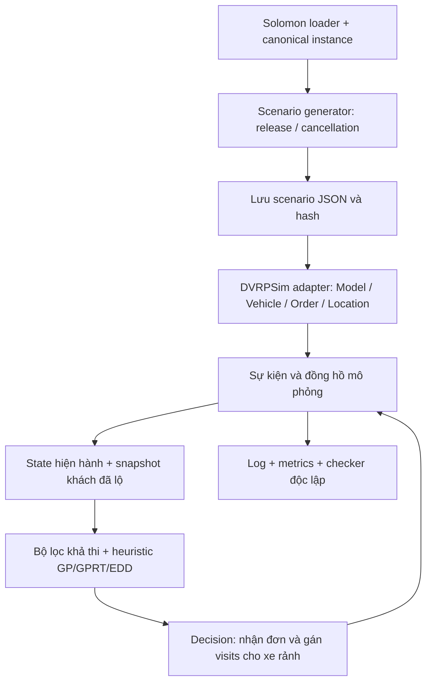
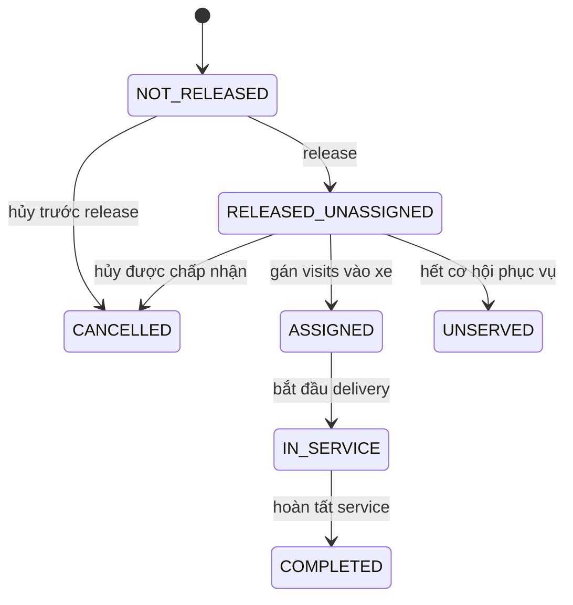

# DVRPSim cho DVRPTW: kịch bản 70% task động, tích hợp GP/GPRT và báo cáo performance

Cập nhật ngày **28/10/2026**. Tài liệu mô tả **hành vi đang chạy trong project**, cách cấu hình và kết quả đo từ kịch bản 70% mới. Cấu hình chuẩn: `configs/dvrpsim_dynamic.json`; phiên bản `dvrpsim==1.0.0`, `simpy==4.1.1`.

Một **task** trong tài liệu là một order giao hàng: lấy hàng tại depot và giao cho một khách Solomon; depot không tính là task. Mỗi instance hiện có 100 task. “70% động” nghĩa là chọn 70 task để áp dụng công thức release động; số thực sự xuất hiện sau thời điểm 0 được báo riêng.

## 1. Phạm vi hiện hành

| Thành phần | Quy tắc thực thi |
|---|---|
| Dữ liệu nền | 56 Solomon VRPTW; giữ nguyên depot, tọa độ, demand, fleet, capacity, time window và service time |
| Split | 32 train / 12 validation / 12 test cố định |
| Học heuristic | GP/GPRT học offline trên bài toán tĩnh; heuristic được chọn bằng validation |
| Mô phỏng | Áp dụng biểu thức đã học, giữ cố định trong từng episode; không chạy lại GP/RL trên test động |
| Task động | Chọn 70%; lead nguyên 10–15; release = max(0, ready_time − lead) |
| Yêu cầu hủy | Chọn độc lập 5% task; yêu cầu tại release + delay nguyên 1–15 |
| Điều kiện hủy | Chỉ chấp nhận khi chưa gán vào kế hoạch của bất kỳ xe nào |
| Định tuyến | Gọi lại khi release, hủy thành công, hoặc xe đến depot và còn task chưa gán |
| Phạm vi replan | Dựng kế hoạch cho xe rảnh ở depot từ các task hiện biết và chưa gán |
| Cam kết tuyến | Giữ chuyến đã gán đến khi xe về depot; không chèn đơn vào xe đang chạy |
| Đội xe | Số xe/capacity theo instance; một xe được chạy nhiều chuyến |
| Khoảng cách/thời gian | Euclid không làm tròn; một đơn vị khoảng cách tương ứng một đơn vị thời gian |
| Độ trễ quyết định | Có đo wall-clock; mặc định không cộng độ trễ này vào đồng hồ mô phỏng |

Đây là **scenario synthetic tạo từ Solomon tĩnh**. Tỷ lệ 70%, lead và chính sách hủy là lựa chọn của project, không phải thuộc tính mặc định của benchmark hay DVRPSim.

## 2. Framework và kiến trúc tích hợp

DVRPSim là engine mô phỏng sự kiện rời rạc. Engine quản lý đồng hồ, xe, order và thực thi visits; thuật toán định tuyến nhận state rồi trả decision. Có thể viết thuật toán định tuyến bên ngoài engine. Xem [khái niệm chính thức](https://sztaki-hu.github.io/dvrpsim/src/introduction/basics.html) và [state/decision/routing callback](https://sztaki-hu.github.io/dvrpsim/src/tutorial/tutorial_03a.html).



| Module | Trách nhiệm |
|---|---|
| `vrptw_baselines/data.py` | Parse/validate Solomon, ID gốc và khoảng cách |
| `dvrpsim_dynamic/scenario.py` | Sinh kịch bản có seed, lưu/load JSON, kiểm tra instance hash |
| `dvrpsim_dynamic/simulator.py` | Lớp adapter duy nhất kết nối engine, provider, cancellation, callbacks và metrics |
| `dvrpsim_dynamic/routing.py` | Snapshot thông tin đã biết, bộ dựng tuyến dùng chung giữa các policy |
| `gprt_vrptw/evaluator.py` | Biên dịch biểu thức và tính priority từ feature hiện hành |
| `run_dvrpsim_dynamic.py` | Chọn split/policy/scenario, chạy episode, ghi artifacts và gate |
| `validate_dvrpsim_results.py` | Đọc lại scenario, log và kết quả để đối chiếu độc lập |
| `scripts/report_dvrpsim_performance.py` | Tổng hợp số đo và cập nhật phần performance của tài liệu |

**Ánh xạ sang DVRPSim:** mỗi điểm là một `Location`; mỗi khách là một `Order` có quantity = demand, pickup tại depot, delivery tại khách. Xe có initial location = depot và capacity theo file. Adapter override cả `travel_distance` và `travel_time`. Thời lượng pickup mặc định 0; delivery duration bằng service time Solomon. Không có giới hạn tồn kho hoặc thời gian nạp hàng bổ sung ở depot.

## 3. Các mốc thời gian và ràng buộc

| Ký hiệu/thuộc tính | Ý nghĩa |
|---|---|
| `release_time` / `Order.release_date` | Hệ thống bắt đầu biết và được phép xét task |
| `ready_time` | Sớm nhất được bắt đầu phục vụ khách |
| `due_date` | Muộn nhất được **bắt đầu** phục vụ khách |
| `service_time` | Thời lượng phục vụ/giao hàng tại khách |
| `cancel_time` | Thời điểm yêu cầu hủy được xử lý; chưa chắc hủy thành công |
| arrival / service start / completion | Lần lượt: xe đến, bắt đầu phục vụ, hoàn tất giao |
| H = depot.due_date | Horizon phục vụ và giới hạn quay về depot |

Với xe ở u tại thời điểm t và xét khách i:

```text
arrival_i = t + distance(u, i)
start_i   = max(arrival_i, ready_i)
finish_i  = start_i + service_i
```

Một ứng viên chỉ được xét khi:

1. Task đã release, còn tồn tại và chưa gán xe.
2. `demand_i <= remaining_capacity + 1e-9`.
3. `start_i <= due_i + 1e-9`.
4. `finish_i + distance(i, depot) <= H + 1e-9`.

Ở mỗi bước nối tuyến, vị trí, thời gian và tải còn lại đều được cập nhật trước khi chọn khách tiếp. Xe có thể đến sớm và chờ đến ready time. Phục vụ có thể kết thúc sau due date của khách nếu bắt đầu đúng hạn và vẫn về depot trước H. DVRPSim thực hiện việc chờ earliest start; giới hạn latest start được adapter lọc cứng và checker kiểm lại, không dựa vào engine để tự sửa tuyến trễ. Xem [service duration và earliest service](https://sztaki-hu.github.io/dvrpsim/src/tutorial/tutorial_04.html).

Các ràng buộc khác:

- Mỗi task chỉ được gán/phục vụ một lần; task hủy không được phục vụ.
- Mỗi chuyến có tổng demand không vượt capacity.
- Chỉ dùng số xe vật lý được cấp; xe nạp lại tải khi quay về depot.
- Một tuyến bắt đầu từ depot và kết thúc ở depot.
- Task chưa khả thi không bị xóa khỏi thống kê: tiếp tục chờ, cuối cùng báo unserved nếu không hoàn tất.
- Policy hiện không chủ động reject task để cải thiện chi phí; nhiều task được “accepted” nhưng vẫn chưa được gán xe.
- Số chuyến có thể lớn hơn số xe. Không dùng giới hạn single-trip của solver tĩnh để diễn giải `trip_count` trong simulator.

**Hai loại thời gian:** `env.now` dùng đơn vị benchmark; wall-clock dùng giây/millisecond của máy tính. Khi không có sự kiện xen giữa, engine nhảy đến timestamp kế tiếp. Callback chạy mặc định tức thời trong thời gian mô phỏng, dù mất vài millisecond thực. Muốn mô hình hóa chi phí quyết định phải override `Model._simulate_elapsed_routing_time` và thống nhất đơn vị; đây chưa phải một cờ JSON đang được hỗ trợ.

## 4. Sự kiện nào đang có?

| Sự kiện | Xử lý và trạng thái | Gọi routing? | Log của adapter |
|---|---|---|---|
| Khởi tạo | Tạo locations/vehicles; lên lịch release, cancellation và horizon | Không có tick định kỳ ban đầu | Thể hiện qua manifest và các sự kiện kế tiếp |
| Release task | Provider gọi public `request_order`; order trở thành thông tin hiện biết | Có | `order_release` |
| Release của task đã hủy trước đó | Tombstone chặn provider, order không vào state router | Không do release này | `order_release_suppressed` |
| Yêu cầu hủy | Đọc lại trạng thái và assignment tại đúng timestamp | Chỉ khi hủy thành công | `cancellation_request`, sau đó accepted/rejected |
| Hủy thành công | Gọi `Order.cancel()` nếu đã release; hoặc lưu tombstone nếu chưa release | Có | `order_cancelled` nếu có order; `cancellation_accepted` |
| Hủy bị từ chối | Giữ order; ghi lý do assigned/completed/already cancelled/invalid state | Không | `cancellation_rejected` |
| Routing/decision point | Chụp state, lọc ứng viên, dựng tuyến cho xe rảnh | Chính là lần gọi policy | `routing_decision`, `dispatch` nếu có kế hoạch mới |
| Xe rời visit | Engine thực thi leg tiếp theo, cộng khoảng cách | Không | `vehicle_departure` |
| Xe đến khách | Cập nhật vị trí; bắt đầu chờ hoặc phục vụ | Không chỉ vì đến khách | `vehicle_arrival` |
| Xe đến depot | Ghi return time khi kết thúc chuyến; kiểm tra task chưa gán | Có nếu còn task chưa gán | `vehicle_arrival` |
| Bắt đầu delivery service | Ghi service start, khóa trạng thái phục vụ | Không | `delivery_service_start` |
| Hoàn tất giao | Order chuyển completed sau service duration | Không chỉ vì hoàn tất giao | `order_delivered` |
| Mốc horizon | Ghi tập task chưa hoàn tất tại H | Không | `horizon_reached` |
| Kết thúc event queue | Kiểm tra xe/order, tính metrics và final state | Không | `episode_finished` |

Engine còn có các sự kiện native pickup, chờ dịch vụ, service finish và chuyển trạng thái xe. Adapter không xuất một dòng JSON riêng cho mọi sự kiện native. Log delivery completion là `order_delivered`; thời lượng service gốc được lưu trong instance. Logging console native được tắt để tránh ghi log trùng.

Visit pickup tại depot có thể tạo sự kiện depot → depot với distance 0 ở đầu chuyến. Nếu còn task chưa gán, callback depot cũng có thể yêu cầu routing tại timestamp này. Vì vậy số callback không đồng nghĩa số lần thay đổi tuyến hay số chuyến.

### 4.1 Trạng thái order



Đây là mapping nghiệp vụ của project, không phải thay tên enum upstream. “Accepted” trong engine là chấp nhận yêu cầu, còn “assigned” là task đã có xe trong kế hoạch; một order có thể accepted nhưng chưa assigned.

Hủy kiểm tra `get_state()["open_orders"][id]["assigned_vehicle"]` hiện hành. **Đã nằm trong tuyến xe thì bị từ chối hủy, kể cả xe chưa rời depot.** Khi đã completed hoặc cancelled, yêu cầu lặp cũng bị từ chối. Hủy không mở lại hoặc sửa tuyến đã cam kết.

### 4.2 Sự kiện cùng timestamp

SimPy chọn priority số nhỏ trước. Adapter và engine đang phối hợp:

1. Các process nội bộ, release và vehicle/service đã lên lịch (priority 0/1/3 tùy loại).
2. Yêu cầu hủy ở priority 4.
3. Routing chờ ở priority 5 để gom các sự kiện cùng timestamp.
4. Mốc horizon priority 6.

Release và hủy cùng lúc: release trước, hủy trước assignment mới. Completion và hủy cùng lúc: completion trước, yêu cầu hủy bị từ chối. Đơn đã assigned từ timestamp trước vẫn không được hủy. Nhiều yêu cầu routing cùng timestamp có thể được gom thành một lần gọi; đây là debounce của engine.

## 5. Replan thực sự diễn ra như thế nào?

“Replan” hiện là **xem lại tập task chưa gán và lập chuyến mới cho xe đủ điều kiện ở depot**. Không chạy một thuật toán tối ưu lại toàn bộ kế hoạch đang thực thi.

```text
khi release / hủy thành công / depot-arrival có task chờ:
    đọc Model.get_state()
    lấy task đã release, open và assigned_vehicle == None
    lấy các xe rảnh ở depot theo thứ tự vehicle_id
    tạo snapshot chỉ từ thông tin khách đã biết
    với từng xe đủ điều kiện:
        bắt đầu ở depot, thời gian hiện tại, full capacity
        lặp: lọc khách khả thi -> tính feature -> chọn priority nhỏ nhất
        cập nhật vị trí, thời gian, capacity của tuyến đang dựng
        trả visits: depot pickup -> các delivery -> depot return
    engine enforce decision và tiếp tục thực thi sự kiện
```

- Xe đang en route hoặc phục vụ khách giữ kế hoạch hiện tại.
- Task mới khi tất cả xe bận sẽ chờ; xe về depot có thể nhận task đó.
- Policy không biết trước release/cancellation tương lai và không cố ý chờ để gom các task tương lai.
- Có thể có callback không dispatch được task nào: không có xe rảnh hoặc không có ứng viên khả thi.
- Chưa có periodic replan, 2-opt, chèn giữa chuyến, đổi xe giữa đường, dynamic traffic hay đổi time window giữa episode.
- Đến/hoàn tất service tại một khách không tự tạo trigger replan cho toàn đội xe trong adapter hiện hành.

### 5.1 Chống nhìn thấy thông tin tương lai

Có hai tập khác nhau:

- **Tập đã biết:** tất cả khách từng release, dùng tạo snapshot/chuẩn hóa. Khách đã hoàn tất hoặc hủy sau release vẫn là thông tin từng được biết.
- **Tập ứng viên U:** task open, chưa assigned; khi dựng một tuyến thì loại dần các task vừa chọn.

Task hủy trước release không được thêm vào snapshot. Chính sách chỉ được cấp snapshot; cả normalized distance, remaining fraction, urgency rank và look-ahead đều không đọc khách chưa release. Lịch release/hủy đầy đủ thuộc phần private của adapter, không truyền cho heuristic.

### 5.2 Vì sao tỷ lệ động cao có thể làm giảm phục vụ?

Ví dụ một khách có ready = 50, due = 60, quãng đường từ depot = 25 và lead = 10. Release tại 40 dẫn đến arrival sớm nhất 65, vượt due = 60. Task đã không còn khả thi ngay lúc công khai, dù bài toán tĩnh có thể phục vụ.

Project giữ nguyên công thức release và benchmark; không dời release để ép khả thi. Do đó cần đọc `infeasible_at_release` cùng served/unserved. Tỷ lệ phục vụ thấp không tự có nghĩa simulator đã chạy một tuyến vi phạm constraint.

## 6. Sinh kịch bản 70% và tái lập

Với N task:

```text
dynamic_count = decimal_half_up(N * 0.70)
cancel_count  = decimal_half_up(N * 0.05)
dynamic_ids   = sample(all_ids, dynamic_count)
cancel_ids    = sample(all_ids, cancel_count)    # luồng RNG độc lập

release_i = max(0, ready_i - randint(10,15)) nếu i được chọn động
release_i = 0                              nếu không được chọn động
cancel_i  = release_i + randint(1,15)       nếu i thuộc nhóm ứng viên hủy
```

Dùng bốn RNG con từ SHA-256 của seed và tên mục đích: chọn nhóm động, chọn nhóm hủy, lead, delay. Nhóm động và nhóm hủy được giao nhau. Thay tỷ lệ hủy không làm đổi release; thay tỷ lệ động có thể làm đổi release/cancel timestamp nhưng vẫn giữ cách chọn ứng viên hủy độc lập.

Ví dụ N = 100: 70 task được chọn động, 30 task còn lại release tại 0; trong 70 task được chọn cũng có thể có task release tại 0 do clipping. Nếu yêu cầu nghiệp vụ là **chính xác 70 task phải xuất hiện sau 0**, cần thay cơ chế chọn ứng viên (chẳng hạn chỉ chọn ready > 15 nếu đủ số lượng), kiểm tra tính khả thi của yêu cầu rồi khóa protocol mới. Chỉnh duy nhất ratio không bảo đảm điều đó.

Scenario được lưu trước khi chạy các policy, có schema/version, rounding, hash instance, seed, rules và metadata từng task. Khi replay, hash/name instance phải khớp. Mọi GP/GPRT/EDD trên cùng instance/scenario seed nhận cùng file scenario.

API hiện hành là `generate_scenario` cùng `ScenarioConfig`. Hàm `make_release_times` còn được giữ để tương thích với thí nghiệm uniform-release cũ; nó không đọc tỷ lệ 70% trong config và không phải generator của các lần chạy được báo cáo ở đây.

Static control luôn release tất cả task tại 0 và không hủy. Các kết quả 30% cũ giữ riêng trong `outputs/dvrpsim_plan_20261028`; kết quả 70% mới ở `outputs/dvrpsim_70pct_20261028`. Không gộp chúng thành một bảng cùng điều kiện.

## 7. Những gì chỉnh được bằng config

Runner đọc `configs/dvrpsim_dynamic.json`; `--config` chọn một file JSON khác.

| Trường có hiệu lực | Mặc định hiện tại | Tác động |
|---|---|---|
| `scenario.dynamic_ratio` | 0.70 | Số task được chọn áp dụng release động |
| `dynamic_lead_min/max` trong scenario | 10 / 15 | Lead lớn hơn thường công khai sớm hơn so với ready |
| `scenario.cancel_candidate_ratio` | 0.05 | Số ứng viên/yêu cầu hủy, không phải số hủy thành công |
| `scenario.cancel_delay_min/max` | 1 / 15 | Độ trễ yêu cầu hủy kể từ release |
| `methods` | gprt, gp, edd | Có thể chọn thêm greedy; chỉ các policy được nêu được chạy |
| `training_seeds` | 5 seed 20260914–20260918 | Chọn artifact của từng phương pháp học |
| `policy_root` | outputs/gprt_vrptw/reduced_main | Gốc artifact chung cho GP và GPRT |
| `policy_roots` nếu có | Ghi đè theo phương pháp | Gốc riêng cho gprt/gp; ưu tiên hơn policy_root |
| `pilot_validation_instances` | c102, c206, r104, rc203 | Phải thuộc validation split cố định |
| `pilot_scenario_seeds` | 20261025, 20261026 | Kịch bản động của pilot |
| `test_scenario_seeds` | 20261025, 20261026, 20261027 | Kịch bản động của final |
| `solomon_root` | data/data/Solomon | Runner nghiên cứu hiện yêu cầu đủ 56 Solomon |
| `split_manifest` | Manifest split đã khóa | Nội dung phải khớp cách chia 32/12/12 |
| `dvrpsim_version` | 1.0.0 | Kiểm tra phiên bản cài, không tự tải/chuyển phiên bản |

Tên lead/delay trong bảng là field bên trong object `scenario`. Ratio phải thuộc [0,1]; lead/delay là số nguyên không âm, min <= max. Một số lượng nhỏ có thể làm tròn về 0.

**Các trường mô tả, không phải nút điều khiển:** `distance`, `dispatch_policy`, `due_date_semantics` hiện được ghi vào metadata nhưng hành vi tương ứng được cài trong code. Đổi chuỗi mô tả không thay khoảng cách, trigger hay ngữ nghĩa due date. Không thêm một field như `periodic_reoptimization` vào JSON rồi mặc định cho rằng engine sẽ thực hiện.

### 7.1 Các recipe có thể chạy

Tạo một bản config riêng để thử, ví dụ `configs/dvrpsim_custom.json` là bản sao của config chuẩn rồi sửa object:

```json
"scenario": {
  "dynamic_ratio": 0.70,
  "dynamic_lead_min": 20,
  "dynamic_lead_max": 30,
  "cancel_candidate_ratio": 0.05,
  "cancel_delay_min": 1,
  "cancel_delay_max": 15
}
```

Đây là một đoạn trong config đầy đủ. Lead 20–30 đổi thời điểm công khai, cần ghi thành một điều kiện thí nghiệm khác. Chạy/so sánh với cùng instance và seed đã khóa:

```powershell
.venv/Scripts/python.exe run_dvrpsim_dynamic.py --config configs/dvrpsim_custom.json --phase pilot --output-dir outputs/dvrpsim_custom_lead20_30
```

Không có cancellation: đặt `cancel_candidate_ratio = 0`. Release toàn bộ tại 0: runner tự có static control; `dynamic_ratio = 0` chỉ tắt nhóm release động, còn cancellation vẫn hoạt động nếu ratio hủy khác 0.

Chọn policy/seed qua CLI:

```powershell
.venv/Scripts/python.exe run_dvrpsim_dynamic.py --phase smoke --methods gprt gp --training-seeds 20260914 --output-dir outputs/dvrpsim_pair_smoke
.venv/Scripts/python.exe run_dvrpsim_dynamic.py --phase smoke --methods edd greedy --output-dir outputs/dvrpsim_baselines
```

`--methods` và `--training-seeds` ghi đè file config. `--policy-root` đặt một gốc chung và bỏ các gốc riêng trong `policy_roots`. Thiếu artifact yêu cầu thì dừng báo lỗi; không thay ngầm bằng policy khác.

### 7.2 Những thay đổi cần mở rộng code

| Muốn mô phỏng | Chỗ cần sửa | Điều kiện phải giữ/kiểm lại |
|---|---|---|
| Replan định kỳ | Lập process timeout trong adapter, gọi request_for_routing; định nghĩa dừng ở H | Gom event cùng timestamp, tránh callback vô hạn |
| Chèn task vào tuyến đang chạy | routing.py và decision builder trong simulator.py | Giữ leg đang thực thi, vị trí/thời gian/tải thật; kiểm lại mọi downstream window, assignment và cancellation |
| Tốc độ khác 1 hoặc travel time theo traffic | SolomonVehicle.travel_time, bộ lọc khả thi, feature và checker | Mọi tầng dùng cùng mô hình thời gian; distance và travel time không còn được cộng đồng nhất |
| Fleet/capacity/horizon khác benchmark | Canonical model hoặc nguồn dữ liệu/adapter | Ghi rõ là biến thể benchmark; kiểm tra unit, giới hạn xe và capacity mỗi chuyến |
| Xe dị thể, pickup-delivery nhiều điểm | Entity builder, cấu trúc state và routing policy | Precedence, tải trên từng leg, feature và grammar phù hợp |
| Cho hủy task đã assigned | Cancellation handler và route-update policy | Cần chính sách hàng đã pickup, hoàn trả tải/chi phí; quy tắc hiện tại chưa hỗ trợ |
| Thời gian nạp hàng/depot resource | Pickup duration/resource của entity và lịch khả thi/checker | Tránh dự đoán dispatch tức thời trong khi engine thực tế chờ |
| Thêm feature động mới | Feature builder, grammar, model/checkpoint và evaluator | Tách phiên bản feature; huấn luyện và chọn lại heuristic bằng train/validation |
| Train trực tiếp trên simulator | Xây evaluator episode, fitness/reward động và budget mới | Khóa scenario train/validation/test riêng, không RL hoặc chọn mô hình trên test |

Các mở rộng này là việc triển khai và kiểm thử thêm, không phải capability đã bật trong config hiện tại.

## 8. Tích hợp heuristic GPRT vào simulator

### 8.1 Offline và online

```text
offline:
32 Solomon train -> batch 4 -> Transformer sinh biểu thức + GP + RL
                 -> sàng lọc train + chọn bằng 12 validation
                 -> final_heuristic.txt (+ best.pt và metadata nếu có)

online trong episode:
final_heuristic.txt -> parse Tree -> make_priority
current state -> known-customer snapshot -> feasible candidates
              -> feature -> scalar score -> chọn khách -> visits -> engine
```

GPRT sinh **biểu thức heuristic**, không sinh trực tiếp tuyến trong simulator. Khi áp dụng, không chạy Transformer forward, GP search hay optimizer RL ở mỗi decision point. GP thuần nối vào đúng cùng interface; khác nhau ở biểu thức đã học.

### 8.2 Feature và quyết định

Bộ dựng tuyến chỉ chọn trong tập khả thi. Điểm heuristic nhỏ nhất thắng; hòa điểm theo ID gốc. `make_priority` dùng các toán tử bảo vệ của grammar và chỉ tính feature mà biểu thức cần.

| Nhóm | Feature |
|---|---|
| Không gian/tải | d_current, d_depot, demand, remaining_capacity, route_load |
| Thời gian | ready_time, due_date, service_time, arrival_time, slack, wait_time, current_time |
| Tập ứng viên/đội xe | remaining_fraction, remaining_vehicles, next_feasible_fraction, urgency_rank |

Khoảng cách chuẩn hóa theo max(1, khoảng cách xa nhất từ depot trong snapshot đã biết); thời gian theo max(1,H), demand theo max(1,capacity). `remaining_fraction` có tử số là số task chờ trong bước dựng tuyến, mẫu số là số khách đã biết. Urgency/look-ahead chỉ xét tập ứng viên đã lộ.

`remaining_vehicles` giữ cách chuyển thể hiện tại: tỷ lệ xe vật lý chưa được dùng sau lần dispatch đang xét. Nó không phải số xe đang rảnh khi đội xe được tái sử dụng nhiều chuyến. Đây là một giới hạn chuyển ngữ nghĩa từ train tĩnh sang mô phỏng nhiều chuyến, cần ghi nhận khi diễn giải kết quả.

Backend Numba mới tăng tốc `solve` toàn tuyến trong evaluator tĩnh. Simulator vẫn dùng bộ dựng tuyến theo event/snapshot và chấm priority scalar. Không lấy tốc độ train tăng 6,4× hoặc tốc độ dựng tuyến tĩnh tăng 32× làm performance của simulator.

### 8.3 Artifact đang dùng và cách chuyển model

Config hiện đọc `outputs/gprt_vrptw/reduced_main/<method>/<seed>/final_heuristic.txt` cho 5 seed mỗi phương pháp. Đây là artifact pilot lịch sử; GPRT ở đó có 4 cycle. Các biểu thức được khóa trước khi chạy scenario 70%. Báo cáo bên dưới là so sánh **các heuristic sẵn có này**, không phải kết quả của 5 model mới train theo preset chính 32 cycle.

Để dùng model mới, sau khi đã train/chọn bằng validation và có đầy đủ file, thêm vào config đầy đủ:

```json
"policy_roots": {
  "gprt": "outputs/gprt_vrptw/main",
  "gp": "outputs/gprt_vrptw/gp_main"
}
```

Parser kiểm tra operator/arity/terminal/constant thuộc grammar, không thực thi chuỗi code tùy ý. Manifest ghi nội dung biểu thức, số token, source/checkpoint hash và đường dẫn file. Không chọn lại biểu thức sau khi xem test động.

### 8.4 Ví dụ Python trên validation để kiểm tra kết nối

```python
import json
from pathlib import Path
from dvrpsim_dynamic import ScenarioConfig, generate_scenario
from dvrpsim_dynamic import load_selected_policies, run_episode
from vrptw_baselines.data import parse_instance

config = json.loads(Path("configs/dvrpsim_dynamic.json").read_text(encoding="utf-8"))
instance = parse_instance("data/data/Solomon/c102.txt")  # validation
scenario = generate_scenario(
    instance, 20261025, rules=ScenarioConfig(**config["scenario"])
)
scenario.save("outputs/demo70/scenario.json")

policies = load_selected_policies(
    ".", ("gprt", "gp"), policy_root=config["policy_root"],
    training_seeds=(20260914,),
)
for policy in policies:
    result, events = run_episode(
        instance, scenario.release_times, policy.name, policy=policy,
        scenario=scenario, scenario_mode=scenario.mode,
        scenario_seed=scenario.seed, episode_id=f"c102_{policy.name}_70",
    )
    print(policy.name, result["served"], result["cancelled"], result["unserved"])
```

Dùng runner để lưu đầy đủ artifacts cho thí nghiệm chính. API ví dụ chỉ giúp kiểm tra wiring; không có bước train trên validation.

## 9. Protocol chạy và tái lập

| Phase | Instance | Scenario | Policy | Episode |
|---|---|---|---|---:|
| smoke | 1 validation đầu tiên | 1 static + 1 dynamic seed | 1 seed/method và baseline được chọn | 6 với config mặc định |
| pilot | 4 validation: C102, C206, R104, RC203 | 1 static + 2 dynamic seed | 5 GPRT + 5 GP + EDD | 132 |
| final | 12 test cố định | 1 static + 3 dynamic seed | 5 GPRT + 5 GP + EDD | 528 |
| all | pilot rồi final | Giống hai dòng trên | Giống hai dòng trên | 660 |

Mỗi episode = instance × policy/training seed × scenario/mode. Các episode được chạy tuần tự. `all` dừng nếu gate pilot phát hiện vi phạm; final chỉ dùng 12 test theo split đã khóa. 32 train không nằm trong ma trận mô phỏng chính; có thể dùng API hoặc replay có chủ đích để debug một instance.

```powershell
.venv/Scripts/python.exe run_dvrpsim_dynamic.py --phase smoke
.venv/Scripts/python.exe run_dvrpsim_dynamic.py --phase all --output-dir outputs/dvrpsim_70pct_20261028_rerun
.venv/Scripts/python.exe validate_dvrpsim_results.py --results-dir outputs/dvrpsim_70pct_20261028_rerun/pilot
.venv/Scripts/python.exe validate_dvrpsim_results.py --results-dir outputs/dvrpsim_70pct_20261028_rerun/final
.venv/Scripts/python.exe -m scripts.report_dvrpsim_performance --results-dir outputs/dvrpsim_70pct_20261028_rerun --document DVRPSIM_DYNAMIC.md
```

Nếu không nêu output-dir, gốc mặc định mới là `outputs/dvrpsim_dynamic_70pct_cancel5`. Khi đổi rules, dùng thư mục output mới; scenario cũ cùng tên phải có cùng hash, nếu khác runner báo lỗi.

Script báo cáo chuẩn yêu cầu đủ ma trận 132/528 episode, ratio 0,70 và cả GP/GPRT/EDD. Với một run tùy biến nhỏ hơn hoặc tỷ lệ khác, dùng các CSV/JSON của runner để phân tích, hoặc mở rộng script và ghi rõ protocol mới; không đổi nhãn một run khác thành kết quả 70%.

Replay một scenario đã lưu, không sinh lại ngẫu nhiên:

```powershell
.venv/Scripts/python.exe run_dvrpsim_dynamic.py --phase smoke --scenario-file outputs/dvrpsim_70pct_20261028/pilot/scenarios/c102_dynamic_20261025.json --output-dir outputs/dvrpsim_replay70
```

Với replay, smoke chạy một scenario được chỉ định thay vì thêm static control; mặc định vẫn lấy một training seed mỗi method. Seed và rules từ file được giữ nguyên.

### 9.1 Dừng mô phỏng

H là giờ phục vụ/quay về depot. Một process ghi snapshot unserved tại H; event queue vẫn được drain để không bỏ yêu cầu hủy hoặc release bắt buộc sau H trong scenario tùy biến. Engine kết thúc khi không còn event; `simulation_time` có thể lớn hơn `service_horizon`. Router không được tạo một chuyến có return vượt H. Tất cả task được tính vào accounting cuối, kể cả task không thể phục vụ.

## 10. Metrics, kiểm tra và cách đọc performance

| Metric | Định nghĩa và cách đọc |
|---|---|
| requested | Số task gốc, hiện là 100/episode |
| dynamic_selected | Số task được chọn áp dụng release động, hiện 70 trong dynamic mode |
| dynamic_released_after_zero | Số task có release > 0 trong scenario, không phải chỉ số đã phục vụ |
| served / on_time | Hoàn tất / bắt đầu service trong window; đọc cùng unserved |
| cancelled | Số task hủy thành công, tách khỏi unserved |
| unserved | requested − served − cancelled; có danh sách ID và lý do |
| infeasible_orders | Nhóm unserved không thể direct-service ngay lúc release |
| cancellation_requests | Số yêu cầu; accepted + rejected; success rate = accepted / requests |
| served_rate, on_time_rate | Mẫu số requested − cancelled; lưu thêm served_rate_all_orders |
| distance / travel_time | Tổng các leg đã đi; bằng nhau vì tốc độ = 1 trong mô hình hiện tại |
| distance_per_served | Distance / served, vẫn phải đọc cùng workload |
| vehicles_used / trip_count | Số xe vật lý đã dùng / số chuyến đã dispatch |
| callback_latency_mean_ms | Trung bình wall-clock của một routing callback trong episode |
| callback_latency_p95_ms | P95 các callback của episode đó; không phải p95 gộp của mọi episode |
| wall_clock_seconds | Thời gian tạo/chạy/audit episode; không gồm toàn bộ ghi CSV/JSON của runner |
| violation_count | Kiểm tra constraint/coverage/timing/distance và thông tin tương lai |

**Accounting:** `requested = served + cancelled + unserved`. Late-served là task đã phục vụ nhưng bắt đầu ngoài window; khác với unserved do không tìm được chuyến khả thi. Trong một episode đã kiểm tra sạch, late-served và constraint violations phải bằng 0, nhưng unserved có thể khác 0.

So sánh chất lượng theo thứ tự: phục vụ đúng hạn và task bỏ lại → hủy và workload thực tế → distance/số xe/chuyến → chi phí quyết định. Không kết luận thắng chỉ vì quãng đường thấp khi phục vụ ít hơn. Báo cáo có cả so sánh distance trên các cặp phục vụ cùng tập khách và hủy cùng tập khách.

Mean trên 180 episode của GP/GPRT là thống kê mô tả từ 12 instance × 3 scenario seed × 5 training seed; chúng không phải 180 training run độc lập. Độ lệch chuẩn giữa các training seed được tính sau khi lấy mean 36 episode của từng seed. Không dùng pooled episode để tạo một khoảng tin cậy giả độc lập.

### 10.1 Artifacts và audit

| File trong mỗi phase | Nội dung |
|---|---|
| scenarios/*.json | Scenario materialized |
| run_manifest.json | Config thực dùng, platform/version, split, commit/dirty flag, hash code và policy |
| episode_manifest.jsonl | Source policy, instance, seed, scenario path/hash |
| episode_results.jsonl | Toàn bộ routes, assignment/dispatch/return, final states, cancellation và metrics |
| events.jsonl | Log sự kiện có timestamp và episode ID |
| episodes.csv | Metrics từng episode |
| summary_by_policy.csv | Mean/SD theo method, training seed, mode |
| paired_comparisons.csv | GPRT − GP/EDD/greedy theo matched instance/scenario/training seed |
| gate_report.json | Checker constraint tại cuối phase |
| validation_report.json | Đối chiếu độc lập các file kết quả và event log |

Adapter dùng public request/cancel API và chỉ đọc state hiện hành cho assignment. Hàm run_strict để lỗi integration nổi lên thay vì bị `Model.run()` bắt và chỉ ghi log. Checker Python tính lại routes; validator kiểm tra lại event/metrics/scenario sau khi đã ghi file. Có test release/hủy trùng timestamp, hủy sau assignment trước departure, sau completion, hủy lặp, xe bận, infeasible, horizon và không đọc thông tin ẩn.

## 11. Báo cáo performance ở cấu hình 70%

Số liệu trong phần này được tạo từ **lần chạy mới**, không thay nhãn cho kết quả 30%. Artifact gốc: `outputs/dvrpsim_70pct_20261028`. Các bảng dưới đây do script báo cáo tái tạo từ kết quả đã qua validator.

<!-- PERFORMANCE_70_START -->
### 11.1 Đợt chạy và mức động thực tế

Đã chạy mới **132 pilot + 528 final = 660 episode**; checker và validator độc lập đều đạt, 0 vi phạm. Final có 12 test instance, 36 scenario động, 5 heuristic mỗi GP/GPRT và EDD cố định. Không huấn luyện hoặc chọn lại biểu thức trên test động.

Bộ kiểm thử của project: **68/68 test đạt** (tests.xml). Bao gồm test 70%/legacy ratio, cancellation/event ordering, chống future leakage và kiểm tra cách tổng hợp performance.

Mỗi scenario chọn đúng **70/100 task động** và 5 ứng viên hủy. Số release sau 0 trung bình **56.75/100**, min–max **16–70** trên 36 scenario test; phần chênh do clipping release về 0.

### 11.2 Chất lượng phục vụ và chi phí trên test động

Ký hiệu ± là SD giữa mean của 5 training seed; mỗi seed được lấy mean trên 36 episode. EDD có một policy nên không có SD giữa seed. Distance có đơn vị tọa độ Solomon. Các dòng không phải các training run độc lập theo từng episode.

| Policy | Episode | Served/100 | Unserved/100 | On-time/active (%) | Distance |
|---|---|---|---|---|---|
| GPRT | 180 | 91.81 ± 0.13 | 7.94 ± 0.13 | 92.00 ± 0.13 | 3717.09 ± 167.96 |
| GP | 180 | 91.82 ± 0.13 | 7.92 ± 0.13 | 92.01 ± 0.13 | 3759.97 ± 201.84 |
| EDD | 36 | 91.86 | 7.86 | 92.07 | 4123.23 |

Đọc đồng thời served, unserved và cancellation; distance thấp trên các workload khác nhau chưa đủ để kết luận policy tốt hơn.

| Policy | Hủy thành công / request | Tỷ lệ hủy (%) | Xe dùng TB | Chuyến TB | Distance/served TB |
|---|---|---|---|---|---|
| GPRT | 46/900 | 5.11 | 16.94 | 50.78 | 40.14 |
| GP | 46/900 | 5.11 | 16.74 | 50.60 | 40.61 |
| EDD | 10/180 | 5.56 | 17.19 | 51.14 | 44.32 |

Số request là tổng qua các episode của policy, không phải số task gốc khác nhau trong dataset. GP/GPRT có 180 episode động mỗi phương pháp, EDD có 36.

### 11.3 So sánh ghép cặp GPRT − GP

Có **180 cặp** cùng instance, scenario hash và training seed. Theo số task served, GPRT thắng/hòa/thua GP: **14/155/11**.

Mean chênh served: **-0.017 task/episode**; on-time/active: **-0.017 điểm phần trăm**; distance trên tất cả cặp: **-42.885**.

Đối chiếu chặt workload có **146 cặp phục vụ cùng tập customer ID và hủy cùng tập ID**. Trong nhóm này, distance GPRT − GP trung bình **-50.055**, mean phần trăm chênh theo từng cặp **+0.22%**. Dấu âm nghĩa là GPRT ngắn hơn. Đây là thống kê mô tả, chưa là kiểm định ưu thế trên một quần thể độc lập.

Mean chênh tuyệt đối và mean phần trăm theo cặp có thể khác dấu: chênh tuyệt đối cho trọng số lớn hơn về mặt số học đối với các trường hợp có distance lớn, còn tỷ lệ từng cặp chuẩn hóa theo distance GP của cặp đó. Vì vậy hai số này phải được đọc riêng, không dùng một số để thay thế số kia.

### 11.4 Chi phí ra quyết định

| Policy | Mean callback gộp (ms) | Mean p95 theo episode (ms) | Routing/episode (s) | Wall episode TB (s) |
|---|---|---|---|---|
| GPRT | 2.204 | 4.349 | 0.162 | 0.219 |
| GP | 2.327 | 4.571 | 0.172 | 0.231 |
| EDD | 2.145 | 4.282 | 0.158 | 0.217 |

Mean callback gộp được cân theo số callback; cột p95 là trung bình các p95 từng episode, không phải global p95. Callback gồm đọc state, snapshot, feasibility, scoring và tạo decision; không chỉ là thời gian tính biểu thức. Wall episode không bao gồm toàn bộ I/O của runner. Các episode chạy tuần tự; số đo phụ thuộc máy và độ phức tạp biểu thức.

Context chạy được lưu riêng: OMP_NUM_THREADS=1, MKL_NUM_THREADS=1. Không suy thread count của lần chạy cũ từ môi trường lúc tổng hợp báo cáo.

### 11.5 Static control trong cùng simulator

| Policy | Episode | Served TB | On-time/active (%) | Distance TB | Xe TB | Chuyến TB |
|---|---|---|---|---|---|---|
| GPRT | 60 | 100.00 | 100.00 | 1662.41 | 9.97 | 9.97 |
| GP | 60 | 100.00 | 100.00 | 1725.04 | 9.75 | 9.75 |
| EDD | 12 | 100.00 | 100.00 | 2407.35 | 11.00 | 11.00 |

Static control có cùng engine, đội xe nhiều chuyến và policy; chỉ release toàn bộ tại 0 và tắt hủy. Không so trực tiếp BKS VRPTW single-trip với chi phí multi-trip này.

### 11.6 Phân tích theo instance test

| Instance | Release > 0 TB/100 | Served GPRT | Served GP | Distance GPRT | Distance GP |
|---|---|---|---|---|---|
| C105 | 67.67 | 100.00 | 100.00 | 4855.09 | 4897.28 |
| C107 | 66.33 | 100.00 | 100.00 | 4761.42 | 4770.71 |
| C201 | 67.67 | 100.00 | 100.00 | 4994.71 | 5176.27 |
| C205 | 66.33 | 100.00 | 100.00 | 4986.46 | 5130.76 |
| R101 | 70.00 | 57.00 | 57.00 | 1714.58 | 1760.02 |
| R111 | 67.67 | 93.07 | 92.73 | 3203.69 | 3184.85 |
| R206 | 52.33 | 100.00 | 100.00 | 3702.47 | 3676.71 |
| R207 | 33.33 | 100.00 | 100.00 | 2856.92 | 2890.58 |
| RC101 | 69.00 | 71.27 | 71.40 | 3166.97 | 3216.94 |
| RC102 | 51.33 | 80.33 | 80.73 | 3080.35 | 3116.75 |
| RC202 | 51.33 | 100.00 | 100.00 | 4702.20 | 4740.25 |
| RC204 | 18.00 | 100.00 | 100.00 | 2580.21 | 2558.57 |

Các mean GP/GPRT mỗi instance gộp 3 scenario seed × 5 training seed. Các instance có ít served cần đối chiếu lý do infeasible-at-release và chờ xe trong artifact.

| Policy | Unserved: infeasible_at_release | Unserved: chưa dispatch khả thi trước H | Hủy từ chối: assigned | Hủy từ chối: completed |
|---|---|---|---|---|
| GPRT | 975 | 454 | 854 | 0 |
| GP | 975 | 451 | 854 | 0 |
| EDD | 195 | 88 | 170 | 0 |

### 11.7 Kết quả theo training seed

| Policy | Training seed | Served TB | On-time/active (%) | Distance TB |
|---|---|---|---|---|
| GPRT | 20260914 | 91.61 | 91.79 | 3717.22 |
| GPRT | 20260915 | 91.86 | 92.07 | 3990.60 |
| GPRT | 20260916 | 91.94 | 92.13 | 3697.65 |
| GPRT | 20260917 | 91.75 | 91.93 | 3641.71 |
| GPRT | 20260918 | 91.86 | 92.05 | 3538.27 |
| GP | 20260914 | 91.75 | 91.93 | 3641.71 |
| GP | 20260915 | 91.75 | 91.93 | 3641.71 |
| GP | 20260916 | 91.72 | 91.91 | 3696.54 |
| GP | 20260917 | 92.03 | 92.21 | 3702.61 |
| GP | 20260918 | 91.86 | 92.07 | 4117.29 |
| EDD | — | 91.86 | 92.07 | 4123.23 |

### 11.8 Diễn giải kết quả

Trong ma trận này, GPRT phục vụ trung bình 91.81/100 task và GP 91.82/100; chênh lệch mean rất nhỏ và không thể kết luận GPRT cải thiện mức phục vụ. Distance mean của GPRT thấp hơn GP 1.14% trên toàn ma trận, nhưng các tập khách hoàn tất có thể khác nhau. Đối chiếu workload bằng nhau và cả chênh tuyệt đối/phần trăm ở mục 11.3 là cần thiết trước khi nói về lợi thế chi phí.

Chi phí callback mean gộp: GPRT 2.204 ms, GP 2.327 ms. Đây là số đo của cả pipeline ra quyết định trên các biểu thức đã chọn, không phải một tuyên bố GPRT luôn nhanh hơn GP hay tốc độ chạy Transformer online.

Các instance R101, RC101, RC102 có mức phục vụ giảm rõ so với các nhóm còn lại. Cần ưu tiên xử lý mức công khai quá sát time window và giới hạn dispatch tại depot; đổi heuristic đơn thuần không phục hồi được task đã infeasible ngay lúc release.

### 11.9 Phạm vi kết luận và truy xuất

Kết quả mô tả việc chuyển các heuristic pilot đã khóa sang DVRPTW synthetic 70%. GPRT hiện là artifact lịch sử 4 cycle; không dùng bảng này để khẳng định chất lượng của preset chính 32 cycle. Hiệu quả phục vụ, workload và distance được báo cùng nhau; chưa thực hiện kiểm định thống kê hay tái huấn luyện trên simulator.

Môi trường đợt chạy: Python 3.13.7; DVRPSim 1.0.0; SimPy 4.1.1; NumPy 2.4.4; PyTorch 2.11.0; Windows-11-10.0.26200-SP0.

Nguồn số liệu: outputs/dvrpsim_70pct_20261028/performance_summary.json, performance_by_policy.csv, performance_by_seed.csv, performance_by_instance.csv, paired_gprt_gp_full.csv; manifest/scenario/log/results và validation_report trong từng phase. File performance_report.md chứa riêng phần kết quả này.
<!-- PERFORMANCE_70_END -->

## 12. Cách mở rộng đúng với bài toán

Nếu mục tiêu là kiểm tra zero-shot generalization của biểu thức học tĩnh, giữ policy cố định như hiện tại và thay một nhóm rules mỗi lần. Nếu muốn tối ưu vận hành thực sự trong môi trường động, cần thiết kế thêm cơ chế chèn/replan tuyến đang chạy hoặc evaluator train động; phải đo lại với cùng budget và split trước khi kết luận tác dụng của GPRT.

Thay speed, service duration, fleet, feature hoặc cancellation semantics cần cập nhật đồng bộ entity, feasibility, state/priority và checker. Một mô hình engine phong phú hơn không tự khiến heuristic hiện tại biết thông tin đó. Dùng config mới, scenario đã lưu và source/version hash để mỗi kết quả có thể truy xuất lại.

## 13. Nguồn và ghi nhận

- [DVRPSim repository](https://github.com/sztaki-hu/dvrpsim): mã nguồn/framework.
- [Basic concepts](https://sztaki-hu.github.io/dvrpsim/src/introduction/basics.html): engine, visits và thuật toán định tuyến.
- [Routing procedure](https://sztaki-hu.github.io/dvrpsim/src/tutorial/tutorial_03a.html): state, decision và callback.
- [Order features](https://sztaki-hu.github.io/dvrpsim/src/tutorial/tutorial_04.html): service duration và earliest service start.
- [Release/request tutorial](https://sztaki-hu.github.io/dvrpsim/src/tutorial/tutorial_02.html): public request/provider API.
- Horváth & Tamási (2025), *A general modeling and simulation framework for dynamic vehicle routing*, [DOI 10.1016/j.ejtl.2025.100159](https://doi.org/10.1016/j.ejtl.2025.100159).

API và priority trong tài liệu được đối chiếu trực tiếp với package 1.0.0 đang cài trong .venv, gồm model.py, environment.py, elements/order.py và elements/vehicle.py. Cơ chế dispatch, tỉ lệ động/hủy, snapshot và metrics là lớp chuyển thể riêng của project.

