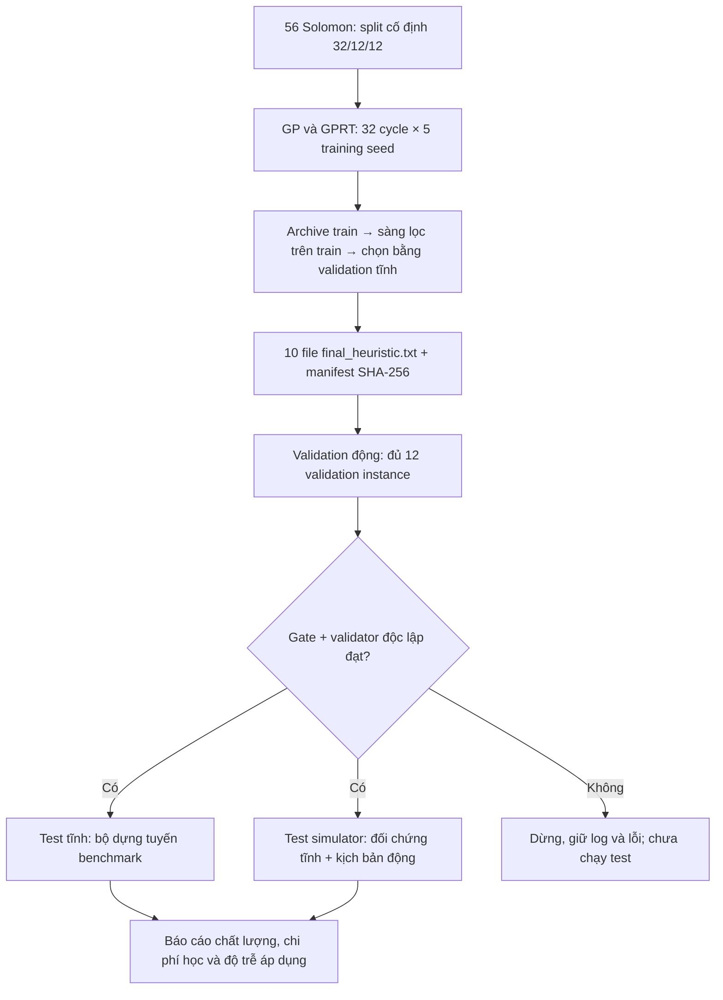

# Luồng end-to-end: huấn luyện GP/GPRT 32 cycle → đánh giá tĩnh → mô phỏng động

Ngày chốt: **29/10/2026**. Đây là protocol và script cho **đợt chạy mới**;
không phải báo cáo rằng ma trận 32 cycle đã chạy xong. Số liệu 4 cycle trong
`outputs/gprt_vrptw/reduced_main` vẫn là kết quả lịch sử.

## 1. Luồng thực hiện

Chạy từ thư mục gốc project:

```powershell
.venv/Scripts/python.exe run_end_to_end.py --output-dir outputs/end_to_end_32cycle/run_01
```

Linux/Colab dùng cùng script, thay `.venv/Scripts/python.exe` bằng `python`.
Dependencies: `python -m pip install -r requirements.txt`;
có thể thêm `python -m pip install -r requirements-fast.txt` để dùng Numba.



Thứ tự thực thi trong script: `train` → `lock_heuristics` →
`dynamic_validation` → `static_test` → `dynamic_test` → `report`.
Không cập nhật GP/RL, đổi biểu thức hoặc chọn mô hình sau khi đã xem test.

## 2. Chia dữ liệu trước khi sinh sự kiện

| Nhóm | Instance gốc | Vai trò |
|---|---:|---|
| Train | 32 | Fitness, batch train và screening train |
| Validation | 12 | Chọn heuristic trên tĩnh; kiểm tra mô phỏng động |
| Test | 12 | Đánh giá cuối trên tĩnh và simulator |

Split được kế thừa từ `gprt_vrptw/splits.py`, phân tầng C1/C2/R1/R2/RC1/RC2.
Chia theo instance gốc; không chia ngẫu nhiên các đơn hoặc các kịch bản của cùng
instance sang nhiều nhóm. Sinh nhiều scenario seed không tạo ra thêm các instance
gốc độc lập. Test tĩnh và test động là hai phép kiểm tra của cùng các heuristic đã khóa.

Pipeline dùng **đủ 12 validation instance** trong simulator; ghi đè danh sách 4
instance pilot của config động cũ trong bản config riêng của đợt chạy.
Tên phase trong runner vẫn là `pilot`, nhưng ở pipeline này nó mang nghĩa validation
động đầy đủ. Không dùng 32 train instance để báo cáo chất lượng ngoài mẫu.

## 3. Huấn luyện đủ 32 cycle cho cả hai phương pháp

Script đọc `configs/gprt_main.json` làm cấu hình chung, rồi khóa:

| Tham số | Giá trị |
|---|---|
| Phương pháp | GP và GPRT đầy đủ |
| Cycle / training seed | 32 |
| Training seed | 20260914–20260918; 5 seed/phương pháp |
| Population / mẫu Transformer | 64 / 32 |
| Thế hệ GP / cycle | 3 |
| Batch train | 4 instance; 8 batch, 32 cycle phủ dữ liệu 4 lượt |
| Validation | Mỗi 4 cycle và cuối đợt; tối đa 16 ứng viên |
| Test trong lúc train | Tắt bằng `--skip-test` |

GP khởi tạo cây ngẫu nhiên, tiến hóa bằng cùng grammar/evaluator và có thêm
32 ứng viên random exploration/cycle để đối ứng với lượt đánh giá mẫu neural.
GPRT dùng Transformer sinh biểu thức, GP tiến hóa và cập nhật Transformer bằng
REINFORCE từ mẫu neural on-policy cùng elite imitation từ GP. Cá thể GP không
được coi là mẫu on-policy. Screening/archive hiện hành dùng thước đo chung trên train.

Fitness ưu tiên: instance bất khả thi → tỷ lệ chưa phục vụ → số xe → khoảng cách
chuẩn hóa → độ phức tạp cây. Các lựa chọn này là chuyển thể của project.

Cùng cycle/population không đồng nghĩa cùng thời gian hoặc cùng số cache miss.
`training/search_metrics.csv` lưu số request, instance evaluation, cache hit,
thời gian và peak RSS riêng; báo cáo tách chi phí học offline khỏi áp dụng online.

## 4. Lưu, khóa và chuyển biểu thức

Mỗi cặp phương pháp/seed xuất một file UTF-8 chứa biểu thức canonical:

```text
<output>/training/gp/20260914/final_heuristic.txt
<output>/training/gprt/20260914/final_heuristic.txt
... tương tự cho 4 seed còn lại ...
```

Đó là biểu thức tốt nhất theo **validation**, không nhất thiết cây tốt nhất ở cycle
cuối. GP và GPRT đều có `config.json`, `split_manifest.json`, `training_summary.json`;
GPRT còn có checkpoint `best.pt`, `last.pt`, archive và learning curves.

`heuristics_manifest.json` ghi đường dẫn, phương pháp, seed, nội dung biểu thức và
SHA-256 của đúng 10 file. Pipeline xác nhận cả hai phương pháp hoàn tất 32 cycle,
phủ đủ 32 train instance và khớp split/config. Đổi một file đã khóa sẽ làm pipeline dừng.

Config mô phỏng được tạo riêng, đặt `policy_root` và `split_manifest` về thư mục
training mới; loại bỏ `policy_roots` cũ để không vô tình nạp heuristic pilot.
Simulator dùng parser grammar của project để đọc text, không thực thi mã tùy ý.
Manifest simulator phải có đủ 10 heuristic với cùng SHA-256 đã khóa.

## 5. Ba điều kiện đánh giá

| Điều kiện | Đơn xuất hiện | Hủy | Quy tắc xe |
|---|---|---|---|
| Benchmark tĩnh | Biết toàn bộ từ đầu | Không | Một tuyến/xe, fleet Solomon |
| Static control trong simulator | Tất cả tại 0 | Không | Fleet cố định, xe tái sử dụng nhiều chuyến |
| Động trong simulator | Theo công thức release | Có yêu cầu hủy | Cùng engine và fleet nhiều chuyến như static control |

Static control kiểm tra chuyển thể qua adapter và ảnh hưởng môi trường thực thi;
không mặc định mọi ràng buộc giống benchmark tĩnh. Không đối chiếu trực tiếp chi phí
multi-trip với BKS single-trip.

### Kịch bản động cơ sở đã khóa

- Chọn 70/100 đơn: `release=max(0, ready_time-lead)`, lead nguyên 10–15.
- 30 đơn còn lại release tại 0. Trong nhóm 70 đơn được chọn, một số vẫn có release=0.
- Chọn độc lập 5/100 đơn để yêu cầu hủy tại `release+delay`, delay nguyên 1–15.
- Chỉ hủy đơn chưa gán; đã gán thì từ chối, kể cả xe chưa rời depot.
- Dispatch tại release, hủy thành công, xe về depot có đơn chờ; giữ chuyến đã cam kết.
- Chỉ dùng thông tin đã xuất hiện; snapshot/chuẩn hóa/look-ahead không đọc tương lai.
- Euclid không làm tròn, travel time=distance. Giữ capacity, service time và cửa sổ Solomon.
- Lọc tải, hạn **bắt đầu** dịch vụ và khả năng về depot trước horizon; checker kiểm lại.

Đơn không khả thi/chưa phục vụ vẫn ở thống kê. `unserved=requested-served-cancelled`;
tỷ lệ phục vụ/đúng hạn dùng mẫu số `requested-cancelled`. Báo riêng đơn bất khả thi
ngay lúc release. 5% yêu cầu hủy không có nghĩa 5% đơn được hủy thành công.

## 6. Số lượt đánh giá mặc định

| Phép đánh giá | Ma trận | Số lần |
|---|---|---:|
| Validation simulator | 12 instance × (2 scenario động + 1 static) × 11 policy | 396 |
| Test benchmark tĩnh | 12 instance × 11 policy | 132 |
| Test simulator | 12 instance × (3 scenario động + 1 static) × 11 policy | 528 |

11 policy = 5 GPRT + 5 GP + 1 EDD. EDD là baseline không học, không nhân thành
5 model độc lập. Tổng simulator mới là **924 episode**, khác đợt pilot lịch sử 660.

Validation scenario seed: 20261025, 20261026. Test: 20261025–20261027.
Seed có thể trùng giữa hai nhóm vì instance gốc tách biệt. Tất cả phương pháp trên
cùng instance/seed dùng cùng scenario JSON và hash.

Gate và validator phải xác nhận số lượt, split, hash heuristic, lịch sự kiện,
tải, giờ phục vụ, giờ về depot, gán trùng và thông tin tương lai. Validation lỗi
thì dừng trước **cả test tĩnh lẫn test động**. Gate kiểm tra tính đúng, không đặt
ngưỡng chất lượng tùy tiện; mức phục vụ thấp vẫn phải được báo cáo trung thực.

Pipeline cố định điều kiện động ngay từ đầu, không tự dò tham số bằng validation.
Nếu muốn nghiên cứu lead/tỷ lệ động/hủy khác, cần khóa thành điều kiện riêng trước
test và giữ thiết kế so sánh theo instance/scenario. Tập test Solomon hiện tại đã
được xem trong pilot cũ; đợt mới không trở thành một bộ xác nhận hoàn toàn chưa từng thấy.

## 7. Chạy, xem trước và tiếp tục

Xem cấu hình thực và số lượt dự kiến; không tạo output hoặc train:

```powershell
.venv/Scripts/python.exe run_end_to_end.py --dry-run
```

Chạy đầy đủ trên CPU, Numba khi đã cài:

```powershell
.venv/Scripts/python.exe run_end_to_end.py --output-dir outputs/end_to_end_32cycle/run_01 --route-backend numba --threads 1
```

Để dùng backend Python: `--route-backend python`. Colab có CUDA có thể thêm
`--device cuda`; bộ dựng tuyến vẫn chạy trên CPU. Script dùng đúng Python đang gọi
nó cho các runner con, đặt OMP/MKL thread và ghi stdout/stderr vào `logs/`.

Tiếp tục cùng thư mục nếu một stage bị ngắt:

```powershell
.venv/Scripts/python.exe run_end_to_end.py --output-dir outputs/end_to_end_32cycle/run_01 --resume
```

Phải giữ nguyên tham số như `--device`, `--route-backend`, `--threads` khi resume.
Các stage hoàn tất được bỏ qua sau khi kiểm hash artifact; stage chưa hoàn tất chạy lại.
**Resume ở mức stage**, không resume theo cycle: nếu stage train chưa hoàn tất,
cả ma trận training sẽ chạy lại. Không sửa config đã sinh hoặc heuristic trong một run.
Nguồn code, dữ liệu, cấu hình hoặc phiên bản môi trường thay đổi thì dùng thư mục mới.
Script từ chối thư mục có dữ liệu sẵn nếu không có manifest resume phù hợp.

## 8. Đầu ra và cách đọc

```text
<output>/
  pipeline_manifest.json       # trạng thái từng stage, config, source/data hash
  training_config.json
  dynamic_config.json
  heuristics_manifest.json     # 10 biểu thức được khóa
  logs/
  training/                    # GP/GPRT 32 cycle, heuristic text và search metrics
  static_test/                 # route, metric từng instance, gate độc lập
  dynamic/pilot/               # đủ 12 validation instance
  dynamic/final/               # test tĩnh đối chứng + động
  pipeline_summary.json        # số liệu tổng hợp, chi phí offline riêng
  end_to_end_report.md
```

Đọc theo thứ tự: nghiệm đúng → mức phục vụ → số xe/chuyến và quãng đường → độ trễ.
Trên tĩnh, fitness ưu tiên số xe trước khoảng cách. Trên động, chỉ so chi phí khi
đọc cùng workload; dùng `paired_comparisons.csv` theo cùng instance/scenario/seed và
đối chiếu tập served/cancelled ID khi cần. Trung bình thấp hơn chưa chứng minh ưu thế
thống kê. p95 báo cáo là trung bình p95 từng episode; callback gồm toàn bộ bước
đọc state, snapshot, lọc, chấm điểm và tạo decision, không phải thời gian Transformer online.

Tài liệu liên quan: [runner học](RUN_GPRT_VRPTW.md),
[quy ước mô phỏng](../DVRPSIM_DYNAMIC.md). Luồng này không thay đổi slide Beamer.
