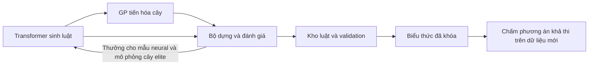

# Thiết kế kỹ thuật hệ thống GPRT cho bài toán định tuyến

**Báo cáo kỹ thuật khóa luận · 25 tháng 11 năm 2026**

Hệ thống học một quy tắc chấm điểm để quyết định bước đi tiếp theo của xe. Đầu ra của quá trình học là một biểu thức có thể đọc, lưu và chạy độc lập. Thiết kế cần trả lời hai câu hỏi khác nhau. Transformer và lập trình di truyền tìm biểu thức bằng cách nào? Khi có biểu thức, bộ điều phối dùng nó để ra quyết định nào và chịu trách nhiệm về những ràng buộc nào?

Cải tiến được khảo sát là giữ nguyên một luật cha và cho Transformer học đặc trưng cần cộng hoặc trừ. Trên 12 bộ test Solomon qua năm hạt giống ngẫu nhiên (seed), phương án này giảm 6,52% quãng đường và 0,90% số xe so với GP. Khi đơn xuất hiện dần và drone phối hợp với xe tải, lợi thế về số đơn đúng hạn đổi chiều giữa hai nhóm tọa độ. Kết quả gắn với cơ chế ra quyết định cụ thể của từng môi trường.

### Kiến trúc huấn luyện và sử dụng



GP là lập trình di truyền (Genetic Programming). GPRT kết hợp GP với Transformer được huấn luyện bằng học tăng cường. Thiết kế kế thừa ý tưởng trao đổi biểu thức giữa hai thành phần từ nghiên cứu của Chen và cộng sự. Bộ đặc trưng định tuyến, fitness, quy tắc giữ nguyên cây cha và giao thức Solomon là các lựa chọn triển khai của khóa luận. [Bài báo GPRT gốc](https://arxiv.org/abs/2504.07779)

### Ranh giới của hệ thống

Bộ sinh xử lý token và cấu trúc cây. Bộ dựng tuyến nắm trạng thái khách, xe và đồng hồ, lọc các hành động khả thi rồi đưa vector đặc trưng vào cây. Bộ đánh giá chấm toàn bộ nghiệm hoặc toàn bộ lượt mô phỏng. Khi triển khai, mỗi lần chọn khách hoặc vị trí chèn chỉ cần tính giá trị biểu thức đã khóa trên các ứng viên.

## Biểu diễn luật và cơ chế điều chỉnh

Một cá thể là cây gồm các lá đặc trưng hoặc hằng số, còn nút trong là toán tử. Chuỗi tiền tố ghi toán tử trước các toán hạng. Chẳng hạn, `sub add d_current wait_time next_feasible_fraction` biểu diễn `(d_current + wait_time) − next_feasible_fraction`. Chuỗi này xác định duy nhất cây vì mỗi toán tử có số đối số cố định.

Grammar có sáu hằng số, các phép số học, so sánh, logic và điều kiện ba nhánh `if_else`. Bộ sinh theo dõi các vị trí con còn thiếu, giới hạn độ sâu và ngân sách token. Mỗi bước chỉ lấy mẫu token vẫn cho phép hoàn tất cây. Token kết thúc xuất hiện khi cây đã đủ nhánh. Phép chia bảo vệ trả về tử số nếu trị tuyệt đối mẫu số nhỏ hơn 10⁻⁹. Giá trị của phép tính được chặn trong khoảng ±10⁶.

### Thay đổi ở các mẫu có hướng dẫn

| Chế độ | Phần cố định trước khi lấy mẫu | Quyết định của Transformer |
|---|---|---|
| Sinh tự do | Token bắt đầu | Sinh toàn bộ cây theo grammar. |
| Hoàn thiện tiền tố | Bỏ lá cuối của một cây có toán tử, giữ phần đầu | Sinh tiếp các token để hoàn tất cây. |
| Điều chỉnh nguyên luật | Chọn dấu cộng hoặc trừ và giữ toàn bộ cây cha | Chọn một lá đặc trưng cho nhánh còn lại. |

Ở chế độ mới, bộ huấn luyện duyệt luân phiên các cặp gồm luật cha và dấu. Luật cha đến từ tập khởi tạo hoặc các cây đã được sàng lọc trên train. Phép ghép tăng hai nút và một mức sâu. Bộ sinh bỏ qua cha vượt giới hạn, đồng thời quay về sinh tự do nếu hết cha hợp lệ. Khi có đủ ứng viên, một nửa số mẫu vẫn sinh tự do để GP có thể khám phá cấu trúc khác. Một cây chỉ gồm một lá cũng có thể làm cha.

### Ví dụ một quyết định đổi khách

Luật ở seed 20260915 tương đương `d_current + 2 × wait_time + due_date − 2 × next_feasible_fraction` trên các đặc trưng chuẩn hóa. Bảng dùng hai ứng viên khả thi giả định để minh họa phép tính. Bộ dựng chọn điểm nhỏ nhất.

| Khách | Khoảng cách | Chờ | Hạn | Tỷ lệ nối tiếp | Điểm khi bỏ hạng tử nối tiếp | Điểm đầy đủ |
|---|---:|---:|---:|---:|---:|---:|
| A | 0,20 | 0,00 | 0,50 | 0,20 | 0,70 | 0,30 |
| B | 0,30 | 0,05 | 0,50 | 0,60 | 0,90 | −0,30 |

Phần khoảng cách, thời gian chờ và hạn giao ưu tiên A. Khi tính thêm khả năng nối tiếp, B được chọn vì còn nhiều khách có thể ghé sau B. Tỷ lệ này chỉ nhìn trước một bước. Việc chọn B không bảo đảm toàn bộ tuyến sẽ tốt hơn.

## Vòng huấn luyện giữa Transformer và GP

Transformer sinh từ trái sang phải, dùng embedding của token và vị trí, mặt nạ nhân quả để chỉ nhìn tiền tố và mặt nạ grammar để loại token sai cấu trúc. Hai cấu hình thực nghiệm đều dùng một tầng, kích thước biểu diễn 32, bốn đầu attention, tầng truyền thẳng 64 và dropout 0,1. Trước chu kỳ đầu, mô hình học mô phỏng các luật khởi tạo qua 16 bước.

### Một chu kỳ huấn luyện

1. Chọn một batch train đã phân tầng theo họ instance. Transformer lấy mẫu các biểu thức có hướng dẫn và tự do. Lưu log-xác suất của các token mà mô hình thực sự lấy mẫu.
2. Ghép cây neural, cây tốt từ kho, luật khởi tạo và cây ngẫu nhiên cho đủ quần thể. GP xếp hạng theo fitness, giữ hai cá thể tốt, chọn bố mẹ bằng đấu giải rồi lai cây con, đột biến hoặc sao chép theo tỷ lệ 0,6 / 0,3 / 0,1.
3. Chấm các mẫu neural ban đầu và quần thể cuối trên cùng batch. Ghi cây, fitness, chu kỳ và nhận dạng batch vào kho. Chọn nhóm cây GP tốt, chấm lại trên tập sàng lọc cố định thuộc train rồi ưu tiên các cây tạo tuyến khác nhau để làm mẫu mô phỏng.
4. Cập nhật Transformer bằng tín hiệu thưởng và mô phỏng. Đến kỳ validation, sàng lọc ứng viên từ kho, chấm trên validation và lưu biểu thức tốt nhất đã gặp. Lưu checkpoint sau mỗi chu kỳ để có thể phục hồi.

### Phần thưởng và hàm mất mát

Với N mẫu neural trên cùng batch, gọi rᵢ là thứ hạng bắt đầu từ 0, các mẫu hòa nhận hạng trung bình. Phần thưởng Rᵢ = 1 − 2rᵢ/(N − 1) nằm trong [−1, 1]. Với N = 1, mã trả về 0. Cấu hình đang xét chuẩn hóa R trong batch thành lợi thế A. Nếu mọi mẫu đồng hạng, nhánh policy không nhận tín hiệu phân biệt.

> L = −mean(Aᵢ × log pᵢ) + α × NLL_elite − β × H

Với mẫu tự do, log pᵢ là tổng log-xác suất các lựa chọn sinh cây. Với mẫu điều chỉnh nguyên luật, chỉ lựa chọn đặc trưng đóng góp log-xác suất khác 0. NLL_elite là âm log-xác suất trung bình trên token hợp lệ khi cho mô hình đọc các tiền tố đúng của cây elite. H lấy trung bình entropy của nhánh sinh và nhánh mô phỏng. Adam cập nhật trọng số với tốc độ học 0,001 và chặn chuẩn gradient ở 1,0.

Việc phân biệt hai nguồn mẫu là điều kiện để diễn giải gradient. Nhánh REINFORCE dùng cây do chính policy hiện tại lấy mẫu. Cây do GP lai hoặc đột biến đóng góp qua nhánh mô phỏng. Xếp hạng theo batch giúp dùng cùng cách tính reward cho hai miền có fitness khác nhau, nhưng đồng thời bỏ thông tin về độ lớn chênh lệch giữa hai nghiệm. [Williams, 1992](https://doi.org/10.1007/BF00992696) · [Mundhenk và cộng sự, 2021](https://proceedings.neurips.cc/paper/2021/hash/d073bb8d0c47f317dd39de9c9f004e9d-Abstract.html)

## Bộ dựng tuyến và bộ mô phỏng

### Solomon tĩnh

Đầu vào gồm depot, giới hạn xe, tải trọng, tọa độ, nhu cầu, thời gian phục vụ và cửa sổ thời gian của khách. Với xe tại i lúc t, thời điểm bắt đầu phục vụ j là max(t + dᵢⱼ, thời điểm mở cửa của j). Ứng viên phải còn đủ tải, bắt đầu phục vụ trước hoặc đúng hạn và có thể về depot trước giờ đóng sau khi hoàn tất dịch vụ. dᵢⱼ là khoảng cách Euclid chưa làm tròn, thời gian đi bằng khoảng cách. [Solomon, 1987](https://doi.org/10.1287/opre.35.2.254)

Biểu thức chấm từng khách còn hợp lệ bằng 16 đặc trưng. Khoảng cách chuẩn hóa theo khoảng cách depot–khách lớn nhất, với mẫu số tối thiểu 1. Thời gian chuẩn hóa theo hạn depot. Khi hòa điểm, hệ thống ưu tiên mã khách nhỏ hơn. Khi hết khách khả thi cho xe hiện tại, bộ dựng đóng tuyến và mở tuyến khác nếu còn xe. Bộ kiểm tra độc lập tính lại tải, giờ đến, khách trùng hoặc thiếu, số xe và quãng đường.

### Xe tải phối hợp với drone

Mỗi hàng CSV gồm x, y, demand, open, close, servicetime, drone_serve và time. Trường time là thời điểm công bố đơn. Bộ lập lịch lấy thời gian phục vụ của xe và drone từ cấu hình phương tiện. Bộ mô phỏng xét các đơn đã xuất hiện theo hạn giao tăng dần. Với mỗi đơn, nó thử gán xe, chặng chèn và phương thức giao. Cây chấm 17 đặc trưng của **phương án chèn**, chẳng hạn thời gian hoặc chi phí tăng thêm, biên thời gian nhỏ nhất của tuyến và việc có mở chuyến mới hay không. Khi hòa điểm, bộ mô phỏng dùng mã xe rồi thứ tự phương án chèn.

Mỗi xe mang một drone. Một lượt bay phục vụ một khách và gặp lại xe ở cuối chặng tương ứng. Lịch phải thỏa tải trọng, quyền bay, thời gian hoạt động của drone, hạn depot và hạn **hoàn tất** phục vụ. Bộ dựng thử ba vị trí chèn cuối của mỗi kế hoạch. Nếu toàn bộ phương án ở đó đều thất bại, cấu hình thực nghiệm mới xét các vị trí sớm hơn. Đơn, xe rảnh và kế hoạch dự kiến có thể được ghép lại trước lúc xuất phát. Sau khi xuất phát, chuyến đã cam kết cho tới khi xe quay về.

### Thời điểm cam kết chuyến

Thời gian gom đơn mặc định là 5 phút. Xe có thể chờ ở depot nếu khách đầu chuyến chưa mở cửa, hoặc xuất phát sớm khi chờ làm lịch mất khả thi. Quy tắc này quyết định thời điểm cam kết xe, còn cây quyết định phương án chèn trong các lịch khả thi. Vì vậy, một luật thường mở chuyến mới có thể giao đúng hạn thêm đơn và đồng thời làm tăng tổng quãng đường.

Luồng Solomon động dùng một cách đánh giá khác. Nó phát lại luật đã học từ Solomon tĩnh trên kịch bản có công bố hoặc hủy đơn và cho phép xe chạy nhiều chuyến. Các bảng năm seed trong báo cáo này dùng Solomon tĩnh và bài xe tải–drone được huấn luyện trực tiếp. Phép chuyển Solomon tĩnh sang động thuộc luồng đánh giá riêng.

## Giao thức lựa chọn và so sánh

### Hàm mục tiêu theo thứ tự ưu tiên

Fitness là một bộ có thứ tự. Khi hai cây khác nhau ở tiêu chí đầu tiên, tiêu chí đó quyết định thứ hạng. Chỉ khi hòa mới xét thành phần tiếp theo.

| Môi trường | Các thành phần theo thứ tự nhỏ hơn tốt hơn |
|---|---|
| Solomon tĩnh | Số instance bất khả thi → tỷ lệ khách chưa phục vụ trung bình → số xe trung bình → quãng đường chuẩn hóa trung bình → độ phức tạp cây. |
| Xe tải–drone | Cờ lỗi ràng buộc bằng 0 cho episode hoàn tất → tỷ lệ đơn chưa giao trung bình → quãng đường có trọng số trên mỗi khách → số xe dùng trung bình → độ phức tạp cây. Lỗi mô phỏng làm dừng lần chấm. |

Trên Solomon, quãng đường chuẩn hóa của một instance là tổng độ dài chia cho tích của số khách và thang khoảng cách của instance. Trên xe tải–drone, chi phí bằng km xe tải + 0,25 × km drone. Tỷ lệ thiếu đơn được cộng bằng phân số trước khi chuyển sang số thực để các trường hợp ngang mức phục vụ được so tiếp bằng quãng đường. Phần phạt độ phức tạp bằng 0,0001 × số nút của cây.

### Cấu hình đã đo

| Thành phần | Solomon tĩnh | Xe tải–drone 100 khách |
|---|---|---|
| Train / validation / test | 32 / 12 / 12, cố định theo instance | Fold 0 có 31 / 16 / 9. Fold 2 có 25 / 8 / 23, tách theo nhóm tọa độ |
| Seed huấn luyện | 20260914 đến 20260918 | 42 đến 46 |
| Chu kỳ × thế hệ GP | 32 × 2 | 8 × 1 |
| Quần thể / mẫu neural / mẫu có hướng dẫn | 16 / 8 / 4 | 12 / 6 / 3 |
| Số token tối đa / độ sâu tối đa | 31 / 4 | 19 / 4 |
| Batch / tập sàng lọc train | 4 / 8 instance | 4 / 6 instance |
| Trọng số mô phỏng α / entropy β | 0,1 / 0,001 | 0,25 / 0,005 |
| Số yêu cầu chấm train mỗi seed | 9.216 | 1.302 ở fold 0 và 1.218 ở fold 2 |

Cả ba phương pháp dùng chung bộ dựng, grammar và quy tắc kiểm tra trong từng miền. Mỗi bốn chu kỳ, hệ thống xét tối đa 12 ứng viên trên validation. Ở Solomon, GP và GPRT cùng nhận bốn luật khởi tạo. Ở xe tải–drone, cả hai nhận bốn luật chọn từ 15 luật trên train. GP thuần dùng khám phá ngẫu nhiên để cân bằng số yêu cầu chấm train. Chi phí sàng lọc, validation, chẩn đoán và số lần thực sự chạy bộ dựng sau khi tra bộ nhớ đệm được ghi riêng.

## Kết quả kiểm chứng thiết kế

### Solomon tĩnh trên 60 cặp seed và instance

| Phương pháp | Tổng số xe | Quãng đường trung bình mỗi instance | Thời gian tìm luật mỗi seed |
|---|---:|---:|---:|
| GP thuần | 553 | 1.475,66 | 14,8 giây |
| GPRT hoàn thiện tiền tố | 561 | 1.412,86 | 68,7 giây |
| GPRT điều chỉnh nguyên luật | 548 | 1.379,46 | 68,7 giây |

Cả ba phương pháp đều phục vụ đủ khách. Theo thứ tự số xe rồi quãng đường, GPRT mới thắng 32, hòa 8 và thua 20 cặp so với GP. So với GPRT hoàn thiện tiền tố, số xe giảm 2,32% và quãng đường giảm 2,36%. Trong cùng đợt chạy, tìm luật bằng GPRT mới tốn khoảng 4,6 lần thời gian của GP. Con số này đo chi phí huấn luyện khi nhiều tiến trình cùng chạy trên máy.

Năm seed dùng lại cùng 12 instance. Lấy mẫu lại 10.000 lần theo cả seed và instance, giữ nguyên ghép cặp, cho khoảng phân vị 95% từ −0,52 đến +0,33 xe/instance cho chênh lệch GPRT mới trừ GP. Khoảng chứa 0. Mức giảm số xe là kết quả quan sát trong đợt đo, còn khả năng giữ được mức giảm trên một tập khác chưa chắc chắn.

### Xe tải–drone trên hai nhóm tọa độ giữ lại

| Tập test | GP thuần | GPRT tiền tố | GPRT nguyên luật |
|---|---:|---:|---:|
| C1 · đơn đúng hạn / 4.500 | 4.468 | 4.483 | 4.481 |
| C1 · tổng km có trọng số | 122.113,34 | 125.614,65 | 126.422,09 |
| R1/R2 · đơn đúng hạn / 11.500 | 9.580 | 9.545 | 9.554 |
| R1/R2 · tổng km có trọng số | 170.924,32 | 171.572,24 | 170.079,02 |

Trên C1, GPRT mới giao thêm 13 đơn so với GP và tăng 3,53% quãng đường. Cả 13 đơn đến từ seed 43. Trên R1/R2, GPRT mới giao ít hơn GP 26 đơn dù đi ngắn hơn. Ở fold 2, cả ba phương pháp giao đủ 4.000/4.000 đơn trên validation C2, do đó khoảng cách quyết định việc chọn luật. Trên R1/R2, số đơn đúng hạn lại phân biệt các luật. Đây là một lý do cụ thể để kiểm tra mức độ đại diện của tập validation.

Phép so sánh xác định lợi ích của cấu hình hoàn chỉnh trên Solomon và giới hạn trên xe tải–drone. Để quy riêng tác dụng cho Transformer khi chọn đặc trưng, một đối chứng tiếp theo có thể giữ nguyên cha, dấu và ngân sách rồi thay lựa chọn đặc trưng bằng lấy mẫu đều. Các tập test đã xuất hiện trong lịch sử dự án. [Số liệu từng seed và kết quả ghép cặp](analysis/gprt_additive_quality.json)

## Kiểm thử và tái lập

### Các điểm cần kiểm tra khi triển khai

| Thành phần | Điều kiện kiểm tra | Hiện vật đối chiếu |
|---|---|---|
| Sinh biểu thức | Giữ nguyên cha và dấu đã cấp. Log-xác suất của mẫu có hướng dẫn khớp phân phối trên đặc trưng. Khi cha hết chỗ, quay về sinh tự do. | `tests/test_gprt_vrptw.py` |
| Nghiệm Solomon | Mỗi khách phục vụ một lần, đúng tải, số xe và cửa sổ thời gian. Tính lại quãng đường từ các chặng. | `route_audit.json` |
| Mô phỏng xe tải–drone | Sự kiện công bố xảy ra trước lúc gán. Chuyến đã xuất phát giữ nguyên. Thử chèn vị trí sớm khi các vị trí cuối đều thất bại. | `tests/test_dvrpsim_drone.py` |
| Đánh giá và phục hồi | Tách train, validation và test. Kiểm tra cấu hình, từ vựng và trạng thái khi đọc checkpoint. Runner xe tải–drone đối chiếu manifest, phương pháp và seed trước khi test. | `last.pt`, `benchmark.json`, `policy.json` |

Đợt kiểm tra đã lưu đạt 90/90 kiểm thử trong bản sao có đủ dữ liệu Solomon. Phát lại 180 nghiệm tĩnh bằng Python, kiểm tra lại từng tuyến và đối chiếu với kết quả Numba cho cùng số xe, cùng quãng đường và 0 vi phạm. Con số 180 gồm 12 instance × 5 seed × 3 phương pháp. [Kết quả kiểm tra tuyến](../outputs/gprt_vrptw/solomon_additive_confirm/route_audit.json)

### Chạy lại từ thư mục gốc

Các lệnh dưới đây dùng Python của môi trường dự án. Đổi đường dẫn Solomon sang thư mục chứa đủ 56 tệp. Cài phụ thuộc Numba cho lệnh chọn backend `numba`. Lệnh xe tải–drone gọi cùng một bộ cờ khi huấn luyện và khi test.

```powershell
python run_gprt_experiment.py --config configs/gprt_solomon_additive.json `
  --data-dir <thu-muc-Solomon> --route-backend numba
python run_dvrpsim_drone.py train --fleet 10 --fold 0 --seeds 42 43 44 45 46 `
  --config configs/dvrpsim_drone_additive.json --retry-earlier-gaps `
  --screen-initial-rules --output outputs/drone_design_f0
python run_dvrpsim_drone.py test --fleet 10 --fold 0 --seeds 42 43 44 45 46 `
  --retry-earlier-gaps --screen-initial-rules --output outputs/drone_design_f0
```

Để lặp lại trên R1/R2, đổi cả hai lệnh drone sang fold 2 và dùng thư mục đầu ra mới. Đối chứng GPRT tiền tố dùng `dvrpsim_drone_iterations.json` trên drone. Trên Solomon, sao chép preset và đổi riêng `guided_mode` thành `complete_prefix`. Với hai seed drone 42–43 của GP và GPRT tiền tố, phân tích sử dụng các lượt đã lưu. Ba seed 44–46 và cả năm seed của GPRT mới được huấn luyện trong đợt xác nhận. [Hướng dẫn chạy và phục hồi dữ liệu Solomon](RUN_GPRT_VRPTW.md)

## Bản đồ triển khai và nguồn đối chiếu

| Tệp hoặc nhóm tệp | Trách nhiệm và dữ liệu trao đổi |
|---|---|
| `gprt_vrptw/grammar.py` và `transformer.py` | Mã hóa cây thành token, kiểm tra grammar, lấy mẫu có mặt nạ và tính log-xác suất. Đầu ra của bộ sinh gồm cây, token, log-xác suất và entropy. |
| `gprt_vrptw/gp.py` và `trainer.py` | Tiến hóa quần thể, tạo tiền tố hướng dẫn, ghép hai nhánh loss, lưu trọng số, optimizer, kho cây và trạng thái ngẫu nhiên. |
| `gprt_vrptw/selection.py` và `splits.py` | Ghi nhận fitness theo batch, lấy ứng viên từ các batch, sàng lọc trên tập train cố định và lập batch theo họ instance. |
| `vrptw_baselines/solver.py` và `gprt_vrptw/evaluator.py` | Dựng và kiểm tra tuyến Solomon, tính feature, fitness và số lượt đánh giá. `fast_routing.py` cung cấp backend Numba. |
| `dvrpsim_drone/routing.py`, `simulator.py` và `evaluator.py` | Tạo kế hoạch chèn, kiểm tra lịch xe–drone, thực hiện sự kiện và tổng hợp fitness theo episode. |
| `run_gprt_experiment.py` và `run_dvrpsim_drone.py` | Nạp dữ liệu và cấu hình, chạy từng phương pháp và seed, lưu luật đã chọn cùng kết quả. |

Chi phí đánh giá được lưu theo hai đại lượng. Một yêu cầu chấm là một lần hỏi kết quả cây trên instance. Nếu đã có kết quả khớp khóa bộ nhớ đệm thì không cần dựng tuyến lại. Với drone, khóa gồm biểu thức, mã băm dữ liệu, giới hạn xe và mã băm cấu hình đánh giá. Cách đếm này giải thích vì sao cùng ngân sách yêu cầu mà số lần chạy mô phỏng và thời gian tìm luật vẫn khác nhau.

### Tài liệu phương pháp

1. Chen, X., Qu, R., Dong, J., Bai, R. và Jin, Y. (2025). Genetic Programming with Reinforcement Learning Trained Transformer for Real-World Dynamic Scheduling Problems. Nền tảng phối hợp GP và Transformer cho lập lịch động. [arXiv 2504.07779v2](https://arxiv.org/abs/2504.07779)
2. Williams, R. J. (1992). Simple statistical gradient-following algorithms for connectionist reinforcement learning. Machine Learning, 8, 229–256. Cơ sở của nhánh policy gradient. [DOI 10.1007/BF00992696](https://doi.org/10.1007/BF00992696)
3. Mundhenk, T. và cộng sự (2021). Symbolic Regression via Deep Reinforcement Learning Enhanced Genetic Programming Seeding. NeurIPS 34. Tham chiếu cách dùng bộ sinh neural để khởi tạo GP. [Kỷ yếu NeurIPS](https://proceedings.neurips.cc/paper/2021/hash/d073bb8d0c47f317dd39de9c9f004e9d-Abstract.html)
4. Solomon, M. M. (1987). Algorithms for the Vehicle Routing and Scheduling Problems with Time Window Constraints. Operations Research, 35(2), 254–265. Cơ sở bài toán định tuyến có cửa sổ thời gian. [DOI 10.1287/opre.35.2.254](https://doi.org/10.1287/opre.35.2.254)
